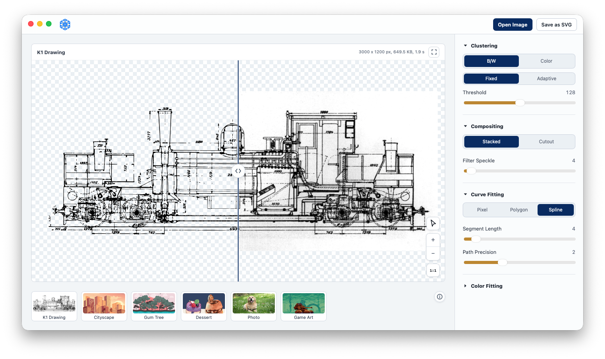

<div align="center">

  
  <h1>VTracer</h1>

  <p>
    <strong>Raster to Vector Graphics Converter</strong>
  </p>

  <h3>
    <a href="https://github.com/visioncortex/vtracer/releases/download/1.0.0-alpha.4/VTracer_1.0.0-alpha.4_x64-setup.exe">Windows App</a>
    <span> | </span>
    <a href="https://github.com/visioncortex/vtracer/releases/download/1.0.0-alpha.4/VTracer_1.0.0-alpha.4_universal.dmg">macOS App</a>
    <span> | </span>
    <a href="https://github.com/visioncortex/vtracer/releases/download/1.0.0-alpha.4/VTracer_1.0.0-alpha.4_x64.AppImage">Linux App</a>
  </h3>

  <p>
    <a href="https://crates.io/crates/vtracer"></a>
    <a href="https://pypi.org/project/vtracer/"></a>
    <a href="https://www.npmjs.com/package/@visioncortex/vtracer"></a>
  </p>

</div>

## Introduction

visioncortex VTracer is an open source software to convert raster images (like jpg & png) into vector graphics (svg). It can vectorize graphics and photographs and trace the curves to output compact vector files.

Comparing to Potrace, VTracer has an image processing pipeline which can handle colored images. VTracer skips Potrace's expensive optimal-polygon search in favor of a fast, linear pipeline that stays faithful to high-resolution images.

Comparing to Adobe Illustrator's Image Trace, VTracer's output is much more compact as we adopt a stacking strategy and avoid producing shapes with holes.

VTracer is originally designed for processing high resolution scans of historic blueprints up to gigapixels. At the same time, VTracer can also handle low resolution pixel art, simulating `image-rendering: pixelated` for retro game artworks.

Technical descriptions of the [tracing algorithm](https://www.visioncortex.org/vtracer-docs) and [clustering algorithm](https://www.visioncortex.org/impression-docs).

## [Desktop App](https://vtracer.visioncortex.org/)

[](https://vtracer.visioncortex.org/)

VTracer App powered by the 1.0 tracing engine:

+ **Native speed**: faster conversions on large images
+ **A/B comparator**: compare the trace against the original
+ **Curve inspector**: inspect fitted curves up close
+ **Curve simplification**: fewer nodes, often half the file size
+ **Seam-free cutout**: gapless shapes with shared boundaries
+ **Watershed clustering**: edge-aware regions for sharper image traces
+ **Adaptive B/W thresholding**: cleaner traces from uneven scans and photos
+ **Fixed color palettes**: snap output to your own colors

## Console App

You can download pre-built binaries from [Releases](https://github.com/visioncortex/vtracer/releases).

You can also install the program from source:

```sh
cargo install vtracer-cli
```

### Usage

```sh
# simplest form
./vtracer input.jpg output.svg

# black & white line art
./vtracer input.jpg output.svg --preset bw

# scanned/photographed line art with uneven lighting
./vtracer scan.jpg output.svg --clustering bw --adaptive

# seam-free mosaic (gapless tessellation)
./vtracer input.jpg output.svg --hierarchical cutout

# watershed region forming, cut to taste
./vtracer photo.jpg output.svg --clustering watershed --watershed-detail 192

# constrain to a fixed palette
./vtracer input.jpg output.svg --palette '#1b1b1b,#e0c088,#5a7d3c,#8fb0d0'
```

Full options:

```sh
Usage: vtracer [OPTIONS] [INPUT] [OUTPUT]

Arguments:
  [INPUT]   Input raster image (positional; or use --input)
  [OUTPUT]  Output SVG (positional; or use --output)

Options:
  -i, --input <INPUT>                        Path to the input raster image
  -o, --output <OUTPUT>                      Path to the output SVG
      --preset <PRESET>                      Start from a preset: bw, poster, photo
      --clustering <CLUSTERING>              Region forming: `color-cluster` (default), `bw`, `watershed`
      --hierarchical <HIERARCHICAL>          Clustering: `stacked` (default) or `cutout` (seam-free mosaic)
  -m, --mode <MODE>                          Curve-fitting mode: `pixel`, `polygon`, `spline`
  -f, --filter-speckle <FILTER_SPECKLE>      Discard patches smaller than X px in size (0..=128)
  -p, --color-precision <COLOR_PRECISION>    Significant bits per RGB channel (1..=8)
  -g, --gradient-step <GRADIENT_STEP>        Color difference between gradient layers (0..=255)
      --simplify <TOLERANCE>                 Simplify curves: fewest cubics within this tolerance in px (try 1–2.5)
      --path-precision <PATH_PRECISION>      Decimal places to use in path coordinates
      --palette <PALETTE>                    Fixed palette: comma-separated hex colors, e.g. '#112233,#445566'
      --palette-file <PALETTE_FILE>          Fixed palette from a file (hex colors, comma/newline separated)
      --max-colors <MAX_COLORS>              Auto-quantize to at most N colors
      --optimize <OPTIMIZE>                  Output optimization: 0 = off, 1 = quantize+cleanup, 2 = + shorthands
      --threshold <THRESHOLD>                Binary mode: fixed threshold 0..=255 (foreground below it)
      --adaptive                             Binary mode: Bradley–Roth adaptive threshold (uneven lighting)
      --adaptive-window <ADAPTIVE_WINDOW>    Adaptive window size in px (0 = auto); implies --adaptive
      --adaptive-t <ADAPTIVE_T>              Adaptive sensitivity: % below local mean (default 15)
      --watershed-detail <WATERSHED_DETAIL>  Watershed: hierarchy cut level (default 128; higher = more regions, uncapped)
  -h, --help                                 Print help
  -V, --version                              Print version
```

The spline fine-tuning flags `--corner-threshold <0..=180>`,
`--segment-length <3.5..=10>`, and `--splice-threshold <0..=180>` are still
accepted but hidden from `--help`: their defaults (60 / 4 / 45) serve
virtually every conversion, and `--simplify` is the knob that actually moves
output size and smoothness.

### New in 1.0

- **Positional arguments**: `vtracer in.png out.svg`.
- **`--hierarchical cutout`** is now a true seam-free mosaic (a gapless
  tessellation with shared boundaries), replacing the old re-clustered cutout.
- **`--palette` / `--palette-file`**: snap colors to a fixed palette
  (nearest in OKLab); **`--max-colors`** auto-quantizes the palette.
- **Binary thresholding**: a tunable fixed cutoff (`--threshold`) or
  **Bradley–Roth adaptive** thresholding (`--adaptive`, with `--adaptive-window`
  / `--adaptive-t`) for scans with uneven lighting.
- **`--simplify <tolerance>`**: paper.js-style curve simplification: re-fits
  smooth runs with the fewest cubics that stay within the tolerance (px),
  typically halving file size; seam-free in cutout mode because shared
  boundaries are simplified once for both faces.
- **`--clustering watershed`**: an alternative region-forming algorithm: a
  hierarchical watershed on the pixel graph (Cousty et al., TPAMI 2009; Najman,
  Cousty & Perret, ISMM 2013), cut at `--watershed-detail`. Content-adaptive
  regions that follow object shape: pairs beautifully with `cutout`.

## Programming Libraries

VTracer 1.0 is a vectorization framework with pluggable stages: segmentation, curve fitting, color fitting, and output optimization — usable from the command line or as a library in Rust, Python, and JavaScript:

| Package | Registry | Source | Use |
| --- | --- | --- | --- |
| `vtracer-cli` | [crates.io](https://crates.io/crates/vtracer-cli) | [`crates/vtracer-cli`](crates/vtracer-cli) | Command-line tool (`vtracer` binary) |
| `vtracer` | [crates.io](https://crates.io/crates/vtracer) | [`crates/vtracer`](crates/vtracer) | Rust library / the framework core |
| `vtracer` | [PyPI](https://pypi.org/project/vtracer/) | [`crates/vtracer-py`](crates/vtracer-py) | Python native extension (pyo3 + maturin) |
| `@visioncortex/vtracer` | [npm](https://www.npmjs.com/package/@visioncortex/vtracer) | [`nodejs`](nodejs) | Node.js WebAssembly build, no native dependency |

### Rust Library

```sh
cargo add vtracer@1.0.0-alpha.4
```

```rust
use vtracer::{ColorImage, Config, FitMode, Hierarchical, Preset, Session};

// Decode with whatever you like, then hand over pixels.
let raw = image::open("in.png")?.to_rgba8();
let (width, height) = (raw.width() as usize, raw.height() as usize);
let img = ColorImage { pixels: raw.into_raw(), width, height };

// one-liner
let svg = Config::default().build()?.to_svg(&img)?;

// presets + per-field config
let mut cfg = Config::from_preset(Preset::Poster);
cfg.mode = FitMode::Polygon;
cfg.hierarchical = Hierarchical::Cutout;  // seam-free mosaic
cfg.max_colors = Some(8);
let svg = cfg.build()?.to_svg(&img)?;
```

Split the pipeline when you want the stages separately — `segment` caches, `finish` re-runs:

```rust
let pipeline = cfg.build()?;
let seg = pipeline.segment(&img)?;        // the expensive part
let doc = pipeline.finish(&seg)?;         // VectorDoc, ready to serialize
```

See [docs.rs/vtracer](https://docs.rs/vtracer/1.0.0-alpha.4/vtracer/) for the full API.

### Python Library

```sh
pip install vtracer==1.0.0a4
```

```python
import vtracer

# one-liners
vtracer.convert_file("in.png", "out.svg")
svg = vtracer.convert_bytes(open("in.png", "rb").read())

# rich, reusable config + presets
cfg = vtracer.Config(mode="polygon", hierarchical="cutout")
cfg.palette = ["#1b1b1b", "#e0c088", "#5a7d3c"]
svg = cfg.convert_bytes(data)
vtracer.Config.poster().convert_file("photo.jpg", "poster.svg")

# watershed region forming
ws = vtracer.Config(clustering="watershed", watershed_detail=192)
svg = ws.convert_file("photo.jpg", "photo.svg")

# binary with adaptive (Bradley–Roth) thresholding
bw = vtracer.Config(clustering="bw", adaptive=True)
svg = bw.convert_file("scan.jpg", "scan.svg")
```

See [`crates/vtracer-py`](crates/vtracer-py/README.md) for the full API.

### Node.js Library

[`@visioncortex/vtracer`](https://www.npmjs.com/package/@visioncortex/vtracer) is available for Node as a WebAssembly build (from the [`nodejs`](nodejs/README.md) package) — image decoding and vectorization both run in wasm, so there is **no native dependency**. Decodes PNG, JPEG, GIF, BMP, and WebP; for other formats, decode yourself and pass raw RGBA to `convertPixels`.

```sh
npm install @visioncortex/vtracer@1.0.0-alpha.4
```

```js
const vtracer = require('@visioncortex/vtracer');

await vtracer.convertFile('in.png', 'out.svg', { mode: 'polygon' });
const svg = vtracer.convertBuffer(buffer, { preset: 'poster' });
const svg2 = vtracer.convertPixels(rgba, width, height, { clustering: 'bw' });

// binary with adaptive thresholding
const bw = vtracer.convertBuffer(buffer, { clustering: 'bw', adaptive: true });
```

### Comparing WebAssembly performance

The benchmark in `scripts/` builds separate release WASM artifacts for the
Node wrapper and the RastaVec browser adapter. It requires Rust with the
`wasm32-unknown-unknown` target, `wasm-pack`, `wasm-opt`, Node.js 18+, Chrome, and a
local RastaVec checkout. The isolated benchmark Vite, TypeScript, and Svelte
tsconfig versions must match the application's lockfile. Install the benchmark
dependencies and build against a clean, pinned VTracer checkout:

```powershell
npm ci --prefix scripts
node scripts\build-bench-wasm.mjs --checkout C:\path\to\vtracer `
  --expected-commit <commit> --app C:\path\to\svg-studio `
  --output C:\path\to\build-output
node scripts\bench-wasm.mjs --build C:\path\to\build-output `
  --app C:\path\to\svg-studio --output bench-results\result.json `
  --warmup 3 --runs 5
```

Use a fresh build directory and output file for each run. To build the JohnQH
fork with its intended sibling VisionCortex rather than the published crate,
also pass `--visioncortex C:\path\to\visioncortex --visioncortex-commit <commit>`
to the build command. The helper patches the isolated adapter manifests and
verifies which dependency Cargo actually resolved. Without this option it
requires published VisionCortex 0.9.3 at its verified source revision. Put
the same `wasm-opt` version on `PATH` for each build so its version and hash
are recorded.

The default corpus is the PNG files directly under the application's `assets`
directory; `--assets` selects another directory, and `--images` takes a
comma-separated list of PNG filenames. `--workload engine` selects the Node
`convertPixels`, Node `convertBuffer`, and browser RGBA measurements;
`--workload auto` selects the actual application Auto workflow; the default
`all` runs both. Set `--browser` or `CHROME_PATH` if Chrome is not installed
at the default Windows location. Run `node --test scripts\bench-utils.test.mjs`
to check the benchmark utilities.

The browser runs headless Chrome, not WebView2. Auto timing includes analysis,
tracing, rasterization, metrics, and candidate selection, but not image
decoding. PNG input is decoded once with `pngjs` and shared as RGBA; this does
not reproduce browser canvas decoding or color management. Node `convertBuffer`
includes its own WASM decode, while `convertPixels` and browser RGBA timings
include JS/WASM transfer and SVG creation. The JSON preserves samples, median,
nearest-rank p95, output fidelity, engine-call counts, source hashes and build
provenance. Memory observations are not peak WASM memory, and five-run p95 is
the largest sample. Results from the limited local corpus are exploratory, not
a general performance claim.

### Comparing native CLI performance

The paired native benchmark measures the release CLI end-to-end for the same
options and inputs on two builds. It includes process startup, PNG decoding,
tracing, SVG serialization, and writing the SVG. The baseline and optimized
samples alternate order per image to reduce systematic timing drift. Build the
two binaries from clean, pinned checkouts, then run:

```powershell
npm ci --prefix scripts
cargo build --release --manifest-path C:\path\to\vtracer-baseline\Cargo.toml -p vtracer-cli
Copy-Item C:\path\to\vtracer-baseline\target\release\vtracer.exe C:\path\to\baseline-vtracer.exe
cargo build --release --manifest-path C:\path\to\vtracer-optimized\Cargo.toml -p vtracer-cli
Copy-Item C:\path\to\vtracer-optimized\target\release\vtracer.exe C:\path\to\optimized-vtracer.exe
node scripts\bench-native.mjs --baseline C:\path\to\baseline-vtracer.exe `
  --baseline-commit <commit> --optimized C:\path\to\optimized-vtracer.exe `
  --optimized-commit <commit> --assets C:\path\to\assets `
  --output bench-results\native.json --warmup 3 --runs 7
```

Use a fresh output path and the same image directory for each comparison. The
default corpus is every PNG directly under `--assets`; `--images` selects a
comma-separated subset. The JSON records individual samples, median and p95,
input and binary hashes, output SVG hashes, and a geometric-mean speedup across
images. Output hash equality is a byte-level check, not a substitute for visual
fidelity metrics.

## Citations

VTracer has since been cited by a few academic papers in computer graphics / vision research. Please kindly let us know if you have cited our work:

+ SKILL 2023 [Framework to Vectorize Digital Artworks for Physical Fabrication based on Geometric Stylization Techniques](https://www.researchgate.net/publication/374448489_Framework_to_Vectorize_Digital_Artworks_for_Physical_Fabrication_based_on_Geometric_Stylization_Techniques)
+ arXiv 2023 [Image Vectorization: a Review](https://arxiv.org/abs/2306.06441)
+ arXiv 2023 [StarVector: Generating Scalable Vector Graphics Code from Images](https://arxiv.org/abs/2312.11556)
+ arXiv 2024 [Text-Based Reasoning About Vector Graphics](https://arxiv.org/abs/2404.06479)
+ arXiv 2024 [Delving into LLMs' visual understanding ability using SVG to bridge image and text](https://openreview.net/pdf?id=pwlm6Po61I)
